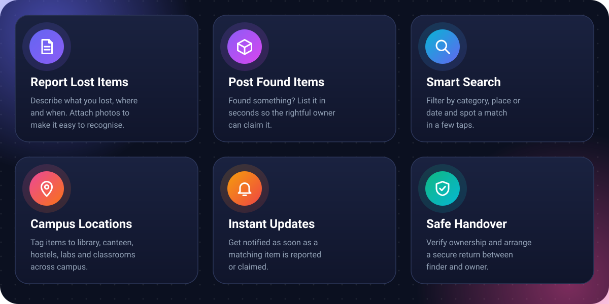
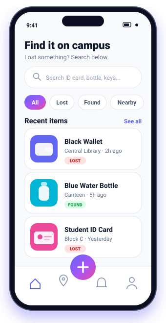
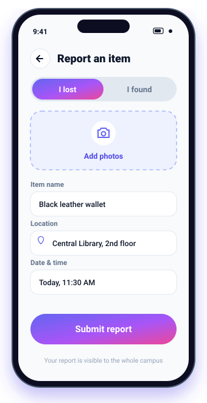
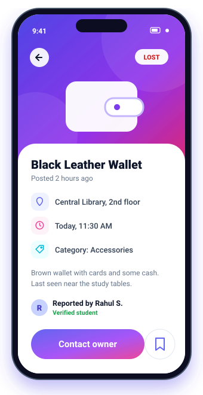

<div align="center">



<br />

<a href="#-features"><b>Features</b></a> &nbsp;•&nbsp;
<a href="#-app-preview"><b>Preview</b></a> &nbsp;•&nbsp;
<a href="#-how-it-works"><b>How it works</b></a> &nbsp;•&nbsp;
<a href="#-getting-started"><b>Get started</b></a> &nbsp;•&nbsp;
<a href="#-roadmap"><b>Roadmap</b></a> &nbsp;•&nbsp;
<a href="#-contributing"><b>Contribute</b></a>

<br /><br />


</div>


## 💡 About

Every campus has the same problem: ID cards, earbuds, water bottles and notebooks go missing every single day, and the only "system" is a noticeboard or a crowded group chat.

**FindItCampus** replaces that chaos with one simple place to **report lost items, post found items and match them up**, so belongings get back to their owners quickly.


## ✨ Features

<div align="center">
  
</div>


## 📱 App Preview

<div align="center">
  
</div>

<br />

<div align="center">

| Home | Report an item | Item details |
|:---:|:---:|:---:|
|  |  |  |

</div>

> 📸 **These are design mockups.** Replace them with real screenshots from your app by adding PNGs to `docs/screenshots/` and updating the image paths above.


## 🔄 How It Works

<div align="center">
  
</div>


## 🛠️ Tech Stack

<div align="center">
  
</div>

<!-- Using Firebase, Room, Retrofit, Jetpack Compose or something else? Add it in docs/techstack.svg or list it here. -->


## 🚀 Getting Started

### Prerequisites

- [Android Studio](https://developer.android.com/studio) (latest stable)
- JDK 17 or newer
- An Android device or emulator

### Installation

```bash
# 1. Clone the repository
git clone https://github.com/aryanchand227/FindItCampus.git

# 2. Move into the project
cd FindItCampus
```

### Run the app

1. Open the project in **Android Studio**
2. Wait for the Gradle sync to finish
3. Pick a device or emulator
4. Press **Run ▶**

Prefer the command line?

```bash
# macOS / Linux
./gradlew assembleDebug

# Windows
gradlew.bat assembleDebug
```

The debug APK is generated in `app/build/outputs/apk/debug/`.

<details>
<summary><b>📂 Project structure</b></summary>

<br />

```
FindItCampus/
├── app/                    # Main Android application module
├── gradle/                 # Gradle wrapper
├── docs/                   # README images and assets
├── build.gradle.kts        # Project-level build config
├── settings.gradle.kts     # Module settings
├── gradle.properties       # Gradle properties
├── gradlew / gradlew.bat   # Gradle wrapper scripts
├── CONTRIBUTING.md
├── LICENSE
└── README.md
```

</details>


## 🗺️ Roadmap

- [x] Project setup & Material 3 design system
- [x] Interactive 55-point campus coordinate map
- [x] Report lost and found items (4-step wizard)
- [x] Cloud image upload & cross-device sync
- [x] Smart vision & automated tag extraction (ML Kit)
- [x] Search, category filters & feed tabs
- [x] Real-time 1-on-1 chat between finder and owner
- [x] Match engine with proximity & similarity scoring
- [x] Notification center for match alerts
- [x] User profile & dynamic resolved items statistics
- [ ] Campus security / admin dashboard

Have an idea? [Open an issue](https://github.com/aryanchand227/FindItCampus/issues) and tell us.


## 🤝 Contributing

Contributions are welcome! Read the [contributing guide](CONTRIBUTING.md), then:

1. **Fork** the project
2. **Create** a branch: `git checkout -b feature/amazing-feature`
3. **Commit** your changes: `git commit -m "Add amazing feature"`
4. **Push**: `git push origin feature/amazing-feature`
5. **Open** a Pull Request

## 👥 Team

<div align="center">
<table>
  <tr>
    <td align="center" width="160">
      <a href="https://github.com/aryanchand227">
        <br /><br />
        <b>Aryan Chand</b>
      </a>
    </td>
    <td align="center" width="160">
      <a href="https://github.com/shiven9500">
        <br /><br />
        <b>Shiven Kudyar</b>
      </a>
    </td>
  </tr>
</table>
</div>

## 📄 License

Distributed under the **MIT License**. See [`LICENSE`](LICENSE) for details.

<br />


